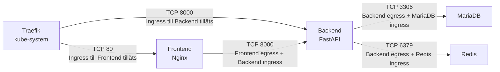
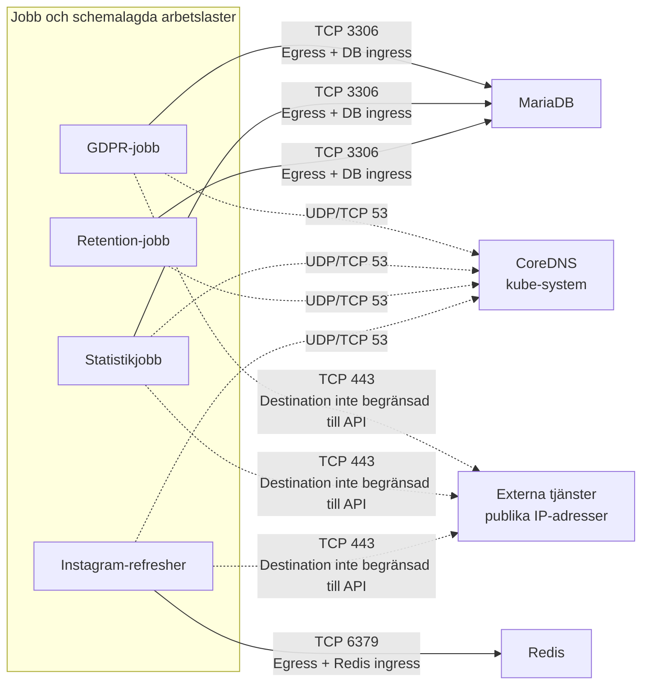
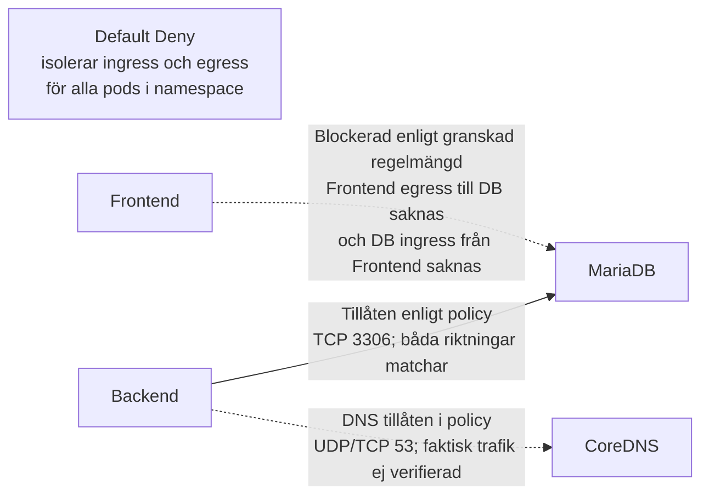

# Nätverksflöden och segmentering

Diagrammen visar trafik som deklareras av den granskade policyuppsättningen. De visar inte observerad trafik. För kommunikation mellan två pods som båda isoleras krävs både källans egressregel och destinationens ingressregel. Trafik och aktiv CNI-verkställighet har inte testats.

## Diagram A – Applikationskommunikation

Flödena är deklarerade av policies. Traefik-poddens egress omfattas inte av applikationsnamespacets default-deny-policy, eftersom Traefik väljs från `kube-system`; diagrammet beskriver därför Traefiks ingressväg utifrån mottagarens ingressregel.

## Diagram B – CronJobs och externa tjänster

GDPR-, statistik- och Instagram-policies använder breda publika CIDR-regler med undantag för listade nät. Källkommentarerna anger Google Calendar/OAuth, Telegram respektive Instagram/Graph API som avsikter, men NetworkPolicy-reglerna begränsar inte destinations-IP till dessa tjänster. Streckade pilar anger policytillåten trafik vars faktiska funktion inte har verifierats i klustret.

## Diagram C – Säkerhetssegmentering

Default Deny betyder att matchade pods isoleras; övriga granskade policies lägger till de tillåtelser som visas. Frontend → MariaDB är ett exempel på en anslutning som saknar både frontend-egressundantag och DB-ingressundantag i den granskade regelmängden. Därför skulle flödet blockeras om den granskade uppsättningen är fullständig för namespace och CNI verkställer reglerna. Blockeringen har inte verifierats med ett praktiskt nätverkstest. Andra policies utanför granskningen kan addera tillåtelser.

### Teckenförklaring

- Heldragen pil: deklarerat tillåtet flöde enligt policyreglerna.
- Streckad pil: deklarerad blockering eller tillåten policyväg vars faktiska trafik inte har verifierats; etiketten anger vilket.
- Diagrammen beskriver policyavsikt och policyanalys, inte mätresultat från ett aktivt kluster.
