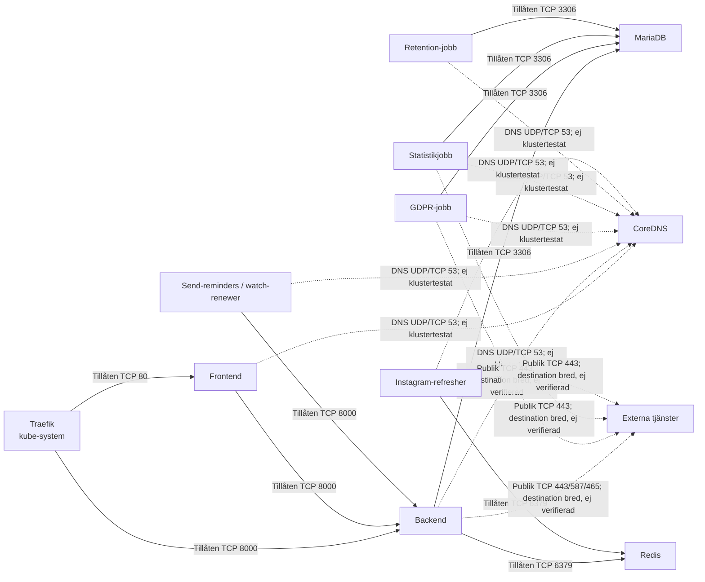

# Nätverksflöden

Heldragna pilar visar trafik som uttryckligen tillåts av policykopiorna. Streckade pilar visar tillåten generell DNS- eller publik egress där faktisk destination/funktion behöver verifieras. Diagrammet visar policyavsikt, inte observerad kommunikation.

Varje pil motsvarar en deklarerad regel. DNS är tillåten i manifest men dess faktiska funktion beror bland annat på klustrets DNS- och CNI-konfiguration. Extern egress anges med breda publika CIDR-regler och är inte verifierad mot tjänstspecifika IP-adresser. Ingen trafik ska tolkas som faktiskt uppmätt.

